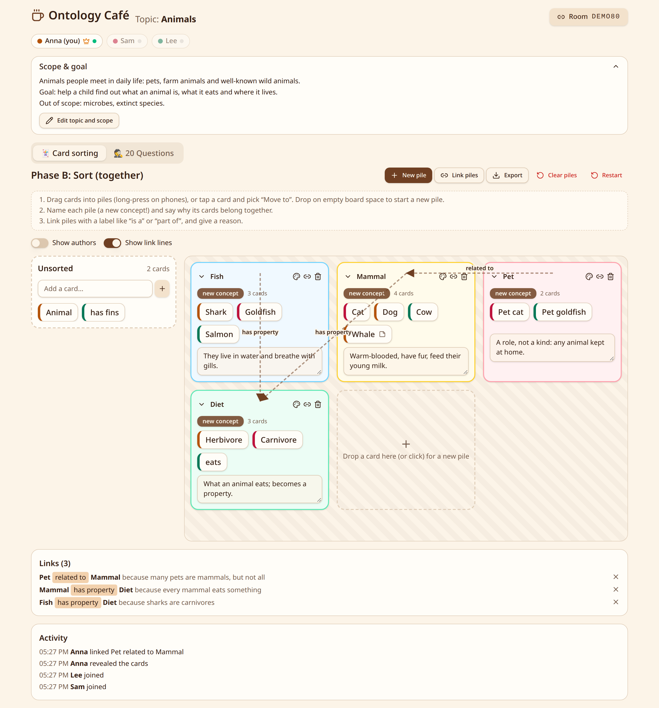
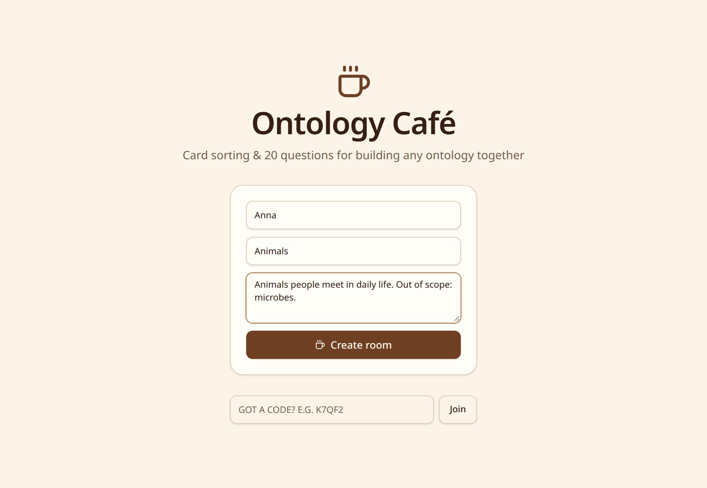
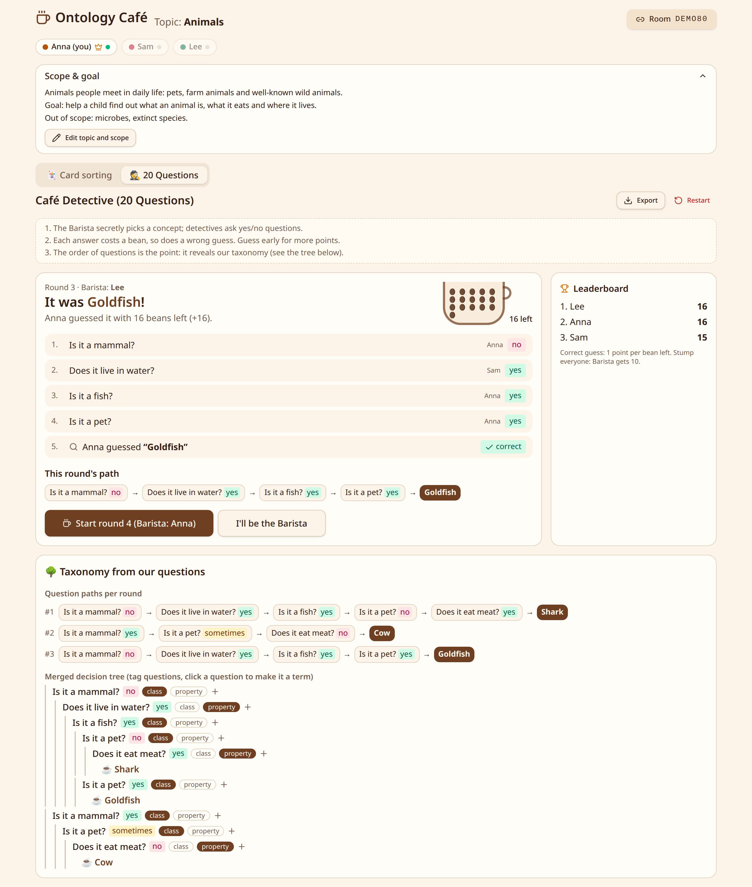
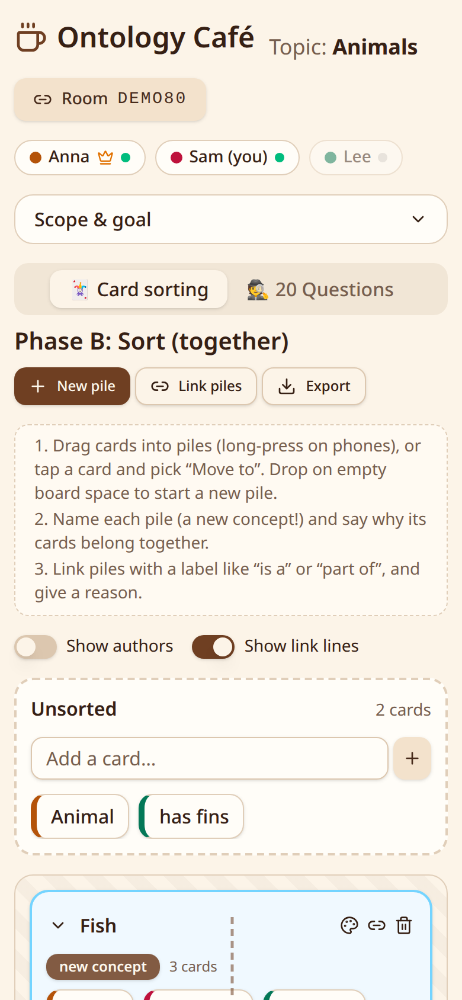

# ☕ Ontology Café

**Build the first draft of any ontology together, live, with card sorting and 20 Questions.**

👉 **Live app: <https://ontology-cafe.lovable.app>**. No sign-up. Make a room, share the link and start.



## Why

Before you open an ontology editor, a team has to agree on its terms, its classes and how they
relate. The Knowledge Representation course gives two simple ways to get that knowledge out of people's heads:

- **Card sorting.** Everyone writes the terms of the domain on cards. The group then sorts the
  cards into piles. Each pile gets a name, often a concept nobody wrote down. Then you link the
  piles and say why. The piles, their names and the links are the start of a class hierarchy.
- **20 Questions.** One person thinks of a concept and the others try to guess it with yes/no
  questions. The answers don't matter much. **Which questions people ask, and in what order,**
  shows how they divide up the domain. Early questions ("Is it a mammal?") point to top-level
  classes. Later ones ("Does it eat meat?") point to properties.

Ontology Café runs both methods as a live multiplayer game in the browser, so a group can do
it in one sitting and take the results home as files.

The name and café look are just the theme (the 20 Questions host is the _Barista_, guesses cost
_beans_). Rooms work for any domain: animals, law, music, hospital logistics, whatever you are modelling.

## Running a session

1. **Create a room.** Open the app, enter your name and, if you want, an **ontology topic**
   (e.g. _Animals_) and a **scope & goal** (what is in, what is out, what the ontology is for). As
   host you can edit both later. Everyone sees the change right away.

   

2. **Share the link.** Click the room code at the top right to copy the room link, then send it to
   your group. Anyone with the link can join by entering a name. It works on phones too.
3. **Write (private).** Each player types terms for the topic, one per card, or pastes a list.
   Nobody can see the others' cards yet, only how many each person wrote. Press **Confirm** when
   you're done.
4. **Reveal.** The cards flip open once everyone has confirmed. The host can also reveal early.
   Duplicates are flagged and can be merged, keeping every author.
5. **Sort, name, link (together).** Drag cards into piles (long-press on phones, or tap a card and
   pick _Move to_). Give each pile a name (a new concept) and a reason. Then **Link piles** with a
   label such as _is a_, _part of_, _has property_ or your own, plus a reason. You can add notes
   to cards (e.g. "only if kept as a pet"). Every change is live for everyone, and an activity
   log shows who did what.
6. **20 Questions.** On the second tab, the Barista secretly picks a concept (from your cards or
   anything else). The detectives ask yes/no questions and the Barista answers _yes_, _no_,
   _sometimes_ or _out of scope_. Each answer and each wrong guess costs a bean, so early guesses
   score more. Tag questions as _class_ or _property_, and turn any question into a new card with one click.
   After a few rounds the app merges all question paths into one **decision tree**.

   

7. **Export.** Both tabs have an **Export** menu: download Markdown or JSON, or copy the
   Markdown. Export at any time. The file always reflects the live state.
8. **Reuse a session.** **Import from export** (next to the card input, in Write and Sort) loads
   an earlier `.json` or `.md` export (card sorting or 20 Questions) or a plain `.txt` list as new
   cards: you pick the terms in a preview, terms already in the room are skipped. Only cards are
   imported, not piles or links.



## What the exports contain

Every export starts with the room code, the **topic** and the **scope & goal**.

| Card sorting                                                         | 20 Questions                                                             |
| -------------------------------------------------------------------- | ------------------------------------------------------------------------ |
| Piles in order, with their name, a _new concept_ flag and the reason | Every round: concept, Barista, result, winner                            |
| The cards in each pile, with notes and authors                       | Every question in order, with answer, _class/property_ tag and who asked |
| All new concepts (the pile names)                                    | Guesses, right and wrong                                                 |
| Links: `from` **label** `to`, with the reason                        | The merged decision tree                                                 |
| Unsorted cards                                                       | Terms suggested from questions                                           |
| An alphabetical list of all unique terms                             | The question path of each round                                          |

Use the Markdown for reports and slides. Use the JSON for scripts.

### From export to ontology (e.g. Protégé)

A practical way to turn a session into a first OWL ontology:

- **Pile names → classes.** Cards in a pile become subclasses or individuals of that class.
  Decide which one together. The card notes help.
- **`is a` links → subclass axioms** (`Shark` _is a_ `Fish` → `Shark ⊑ Fish`).
- **Other links → object properties** (`part of`, `has property`, your own labels). The reasons
  tell you the domain and range.
- **20 Questions → hierarchy and properties.** Questions tagged _class_ near the root of the tree
  are candidate top-level classes. Questions tagged _property_ become properties (often data
  properties, e.g. _eats meat_). _Sometimes_ answers are a good place for a role or a defined class.
  _Out of scope_ answers help you write down the boundary of the scope.
- **Unique terms** are a checklist: each term should end up as a class, property or individual,
  or be dropped on purpose.

## Privacy

- **No accounts.** Players are identified by a random ID kept in their browser.
- **Rooms are public to anyone with the link** (or the room code). Don't put personal or
  confidential data in a room.
- **Card privacy in the write phase is a game rule, not a security feature.** Cards are hidden
  in the interface only. Someone who reads the network traffic could see them.
- To remove a room's data, ask the maintainers. There is no delete button in the app.

## Tech stack

- [TanStack Start](https://tanstack.com/start) (React 19, file routes, SSR) with Vite
- Tailwind CSS v4 and [shadcn/ui](https://ui.shadcn.com), lucide icons
- [Supabase](https://supabase.com) via **Lovable Cloud**: Postgres plus Realtime (one channel per
  room for live updates and presence)
- [dnd-kit](https://dndkit.com) for touch-friendly drag and drop
- Vitest for the export, scoring, duplicate and tree logic (`src/lib/cafe/`)

## Local development

```sh
bun install
bun run dev        # http://localhost:8080
bun run test       # unit tests
bun run lint
bun run build
```

The Supabase URL and publishable key come from Lovable Cloud in `.env` (`VITE_SUPABASE_*`).
Nothing else needs to be configured. Local dev talks to the same database as the live app, so
delete any test rooms you make.

The database schema (`drizzle/`, `supabase/`) and generated files
(`src/integrations/supabase/*`, `src/routeTree.gen.ts`) are managed by Lovable. Don't edit them
by hand. See `AGENTS.md`.

## Deploying

This repository syncs both ways with [Lovable](https://lovable.dev). Pushing to `main` syncs the
code into the Lovable project. Then press **Publish** in Lovable to update
<https://ontology-cafe.lovable.app>. Don't force-push or rewrite pushed history, because Lovable
would lose its project history.
